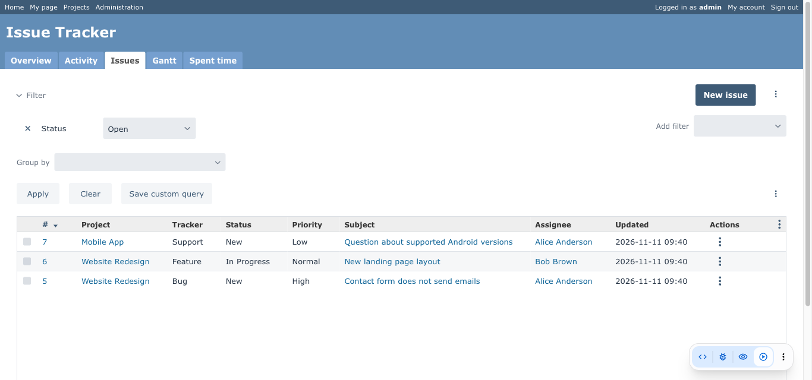
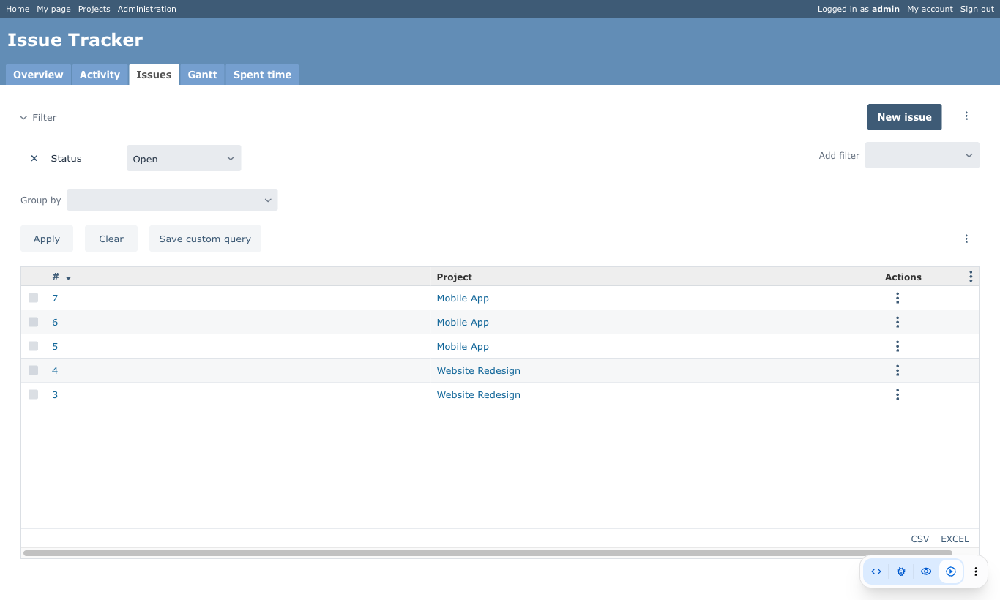
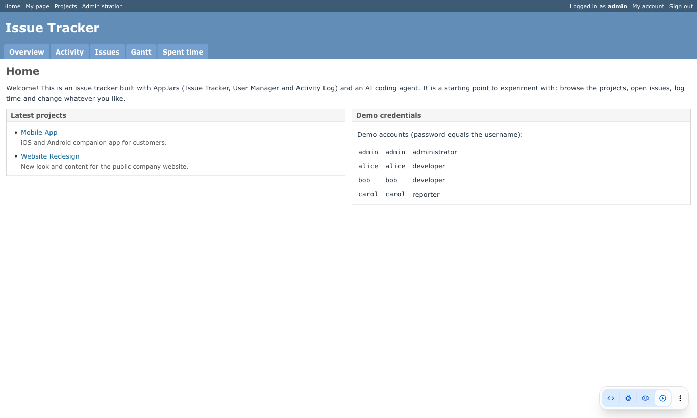
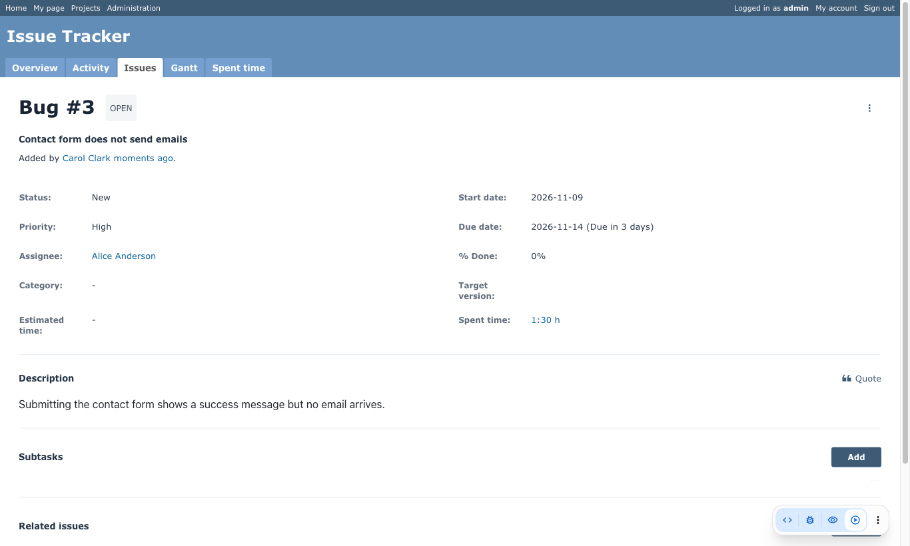
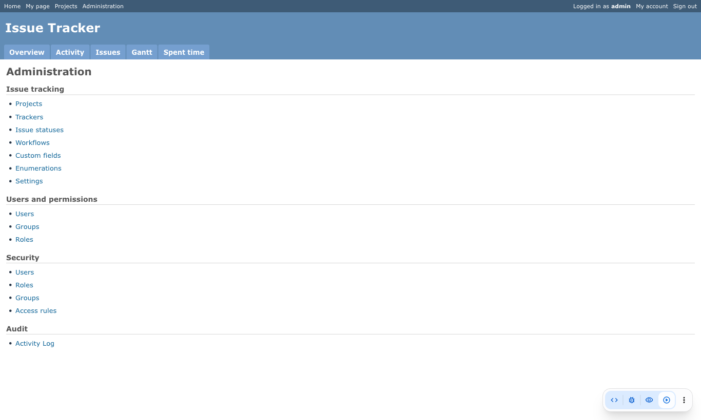

# Build your own Redmine-style issue tracker with AI + AppJars

A working, Redmine-flavoured issue tracker built by an AI coding agent from a handful of
specs, on top of [AppJars](https://www.appjars.com) (Spring Boot + Vaadin). It is a **starting
point to play with**, not a production-ready product.



What you get: projects, issues with trackers, statuses, priorities and workflows, a Gantt chart,
time tracking, "My page", an audit log, user management with login, a Redmine-like look, and demo
data so nothing is empty on first start.

The whole thing is done in a few simple steps. The Git history of this repository follows them,
one commit per step, so you can see exactly what each step changed.

---

## Step 1 — Generate the project with Craft

Open [craft.appjars.com](https://craft.appjars.com) and pick:

| Setting | Value |
|---|---|
| Modules | **Issue Tracker**, **User Manager**, **Activity Log** |
| Application name / artifact | `Issue Tracker` / `issue-tracker` |
| Java / database | 21 / H2 (in memory) |
| Theme | Lumo, primary `#3E5B76`, secondary `#628DB6`, radius `3` |
| Docker | on |

Download the zip, unpack it and `git init`. You now have a Spring Boot 4 + Vaadin 25 app with the
three AppJars already wired in: security, navigation, properties and theme. It also comes with an
`AGENTS.md` that explains the project to coding agents.

## Step 2 — Connect your AI to the AppJars documentation (MCP)

The agent writes much better code when it can read the AppJars documentation instead of guessing.
Add the AppJars docs MCP server. With Claude Code:

```bash
claude mcp add appjars-docs -- npx -y @serverless-dna/mkdocs-mcp https://docs.appjars.com/ "Official AppJars documentation"
```

Or commit a project-level [`.mcp.json`](.mcp.json) like the one in this repo, so everybody who
clones it gets the same setup. Configurations for Cursor, VS Code, Windsurf, Codex, Gemini CLI,
JetBrains and others are on [mcp.appjars.com](https://mcp.appjars.com). This repo also has a
one-line [`CLAUDE.md`](CLAUDE.md) that points Claude Code at `AGENTS.md`.

## Step 3 — Write the specs (spec-driven development)

Instead of one giant prompt, describe *what* you want in small Markdown files under
[`specs/`](specs/):

| Spec | What it asks for |
|---|---|
| [`00-principles.md`](specs/00-principles.md) | Rules for every spec: reuse the AppJars, keep it small, follow `AGENTS.md`, respect free-mode limits, "done" means it builds and boots |
| [`01-redmine-look.md`](specs/01-redmine-look.md) | Dark top bar, blue header, tabs, dense grids, an Administration page |
| [`02-demo-data.md`](specs/02-demo-data.md) | Users, projects, issues and time entries created on first start, through the AppJars services |
| [`03-home.md`](specs/03-home.md) | A Redmine-like home page with projects and demo credentials |
| [`STATUS.md`](specs/STATUS.md) | Where the agent reports what it did and what it dropped |

Each spec has a goal, numbered requirements, what is out of scope, and acceptance criteria you
can check by hand. The principles file matters most: it tells the agent to prefer existing AppJars
features over writing new code, and to drop anything that gets complicated instead of fighting it.

## Step 4 — Run the prompt

The prompt itself is short, because the specs carry the detail: [`PROMPT.md`](PROMPT.md).

```bash
claude "$(cat PROMPT.md)"
```

Any agent that supports MCP works (Cursor, Copilot, Codex…). Paste the contents of `PROMPT.md`.

For this repository the prompt ran in a fresh, non-interactive Claude Code session, with only the
AppJars MCP server and no human input. It took about 15 minutes. Along the way the agent looked up
the services and views it needed in the documentation, implemented the three specs, compiled after
each one, booted the app, checked the log, and wrote [`specs/STATUS.md`](specs/STATUS.md).

## Step 5 — Test it, then iterate

```bash
mvn spring-boot:run
```

Open <http://localhost:8080> and log in. Then click through every tab, as `admin` and as a
regular user.

| User | Password | Role |
|---|---|---|
| `admin` | `admin` | administrator |
| `alice` | `alice` | developer |
| `bob` | `bob` | developer |
| `carol` | `carol` | reporter |

The first pass was not perfect. The look, the home page and "My page" were right, but the issue
grid showed only `#` and `Project`, and the project grid had no columns at all:



Instead of fixing it by hand, write down what you saw as a new spec:
[`specs/04-test-findings.md`](specs/04-test-findings.md). Then run a short follow-up prompt,
[`PROMPT-2.md`](PROMPT-2.md). The agent found in the documentation that Issue Tracker reads its
default columns from its settings, which start empty, and made the demo data fill them in. A third
small prompt, [`PROMPT-3.md`](PROMPT-3.md), leaves room in free mode to create new issues right away.

That loop is the whole method: **test → write the finding as a spec → prompt → test again.**

| Home | Issue | Administration |
|---|---|---|
|  |  |  |

## Step 6 — Deploy

The project ships with a multi-stage `Dockerfile` and a `compose.yaml`. No Java or Maven is needed
on the host:

```bash
docker compose up -d
```

This builds the production bundle and starts the app on port 8080. It runs anywhere that runs a
Docker image or a Dockerfile: a VPS, Railway, Render, Fly.io, Google Cloud Run, Azure Container
Apps…

Before you put it on the internet:

- The database is **in-memory H2**: data is lost on restart. Point `spring.datasource.*` at
  PostgreSQL to keep it (see `application.properties`).
- Change `com.appjars.usermanager.encoding.secret.key` and the demo passwords, and remove the demo
  credentials box from the home page.
- Set the public URL in `COM_APPJARS_USERMANAGER_EXTERNAL_URL` and `APPJARS_ISSUETRACKER_URL_BASE`.
  Set the SMTP settings (`.env.example`) if you want notification emails.

---

## Free mode

No license key is needed. Issue Tracker's free mode allows five users, five open issues and ten
time entries a day, which is plenty to play with. A license key in `application.properties` lifts
the limits. See [appjars.com](https://www.appjars.com/).

## Make it yours

Some ideas for your next spec: per-project tabs, a roadmap page, email notifications, PostgreSQL,
single sign-on, your own logo. Write a spec, run the prompt, test.

## Project notes

- Spring Boot 4.1 + Vaadin 25.2, Java 21, Maven. `mvn clean package -Pproduction` for a
  production jar.
- Logging uses Log4j2 instead of Logback, because Activity Log and Issue Tracker need it.
- [`AGENTS.md`](AGENTS.md) has the project layout and the rules that are easy to break.
- AppJars documentation: [Issue Tracker](https://docs.appjars.com/issue-tracker/overview/) ·
  [User Manager](https://docs.appjars.com/user-manager/overview/) ·
  [Activity Log](https://docs.appjars.com/activity-log/overview/)

## License

The code in this repository is released under the [Apache License 2.0](LICENSE). The AppJars
modules it depends on are commercial software with a free mode. See
[appjars.com](https://www.appjars.com/).
